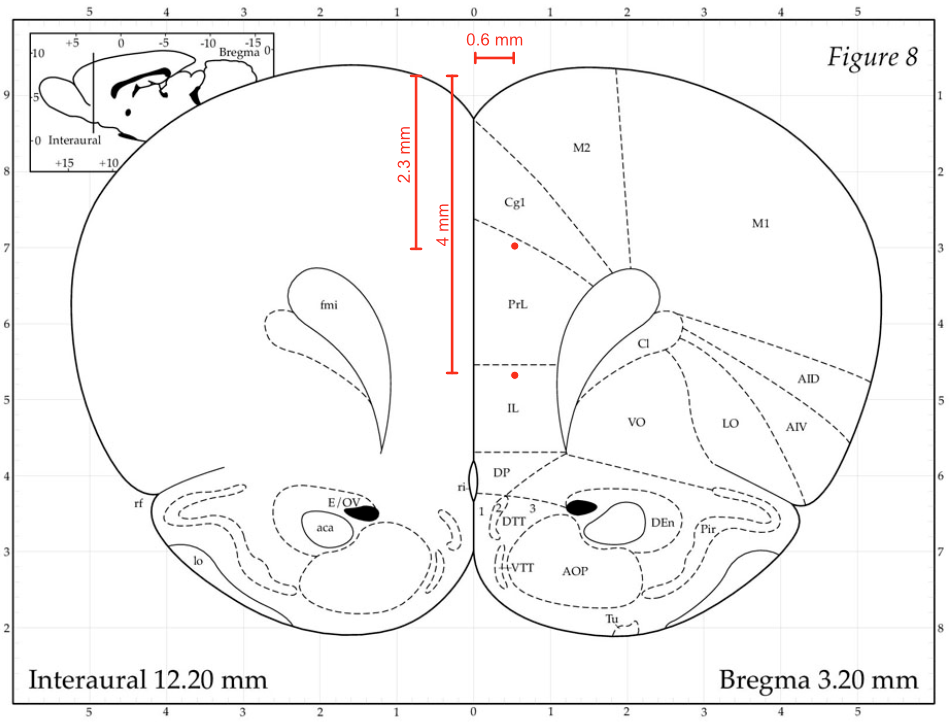

# BGF2: mPFC lesion, 2026-02-26

| | |
|---|---|
| Target | ACC-PL + PL-IL, bilateral |
| Weight | 270 g |
| Drug | NMDA 0.12 M, 100 nl per site |
| Bregma-lambda | 8.14 mm (AP scaled) |

## Injection sites

DV from brain surface. Atlas = target before scaling.

| Site | AP | ML | DV | Atlas AP | Atlas ML |
|---|---|---|---|---|---|
| PL-IL | 2.51 | 0.65 | 4 | 2.7 | 0.65 |
| ACC-PL | 2.51 | 0.65 | 2.3 | 2.7 | 0.65 |
| PL-IL | 3.11 | 0.65 | 4 | 3.2 | 0.65 |
| ACC-PL | 3.11 | 0.65 | 2.3 | 3.2 | 0.65 |
| PL-IL | 2.44 | -0.89 | 4 | 2.7 | -0.65 |
| ACC-PL | 2.44 | -0.89 | 2.3 | 2.7 | -0.65 |
| PL-IL | 3.11 | -0.89 | 4 | 3.2 | -0.65 |
| ACC-PL | 3.11 | -0.89 | 2.3 | 3.2 | -0.65 |

## Notes

Volume increased to 100 nl and sites per ML reduced from 3 to 2, so 8 sites in total for the bilateral lesion.

## Plan

