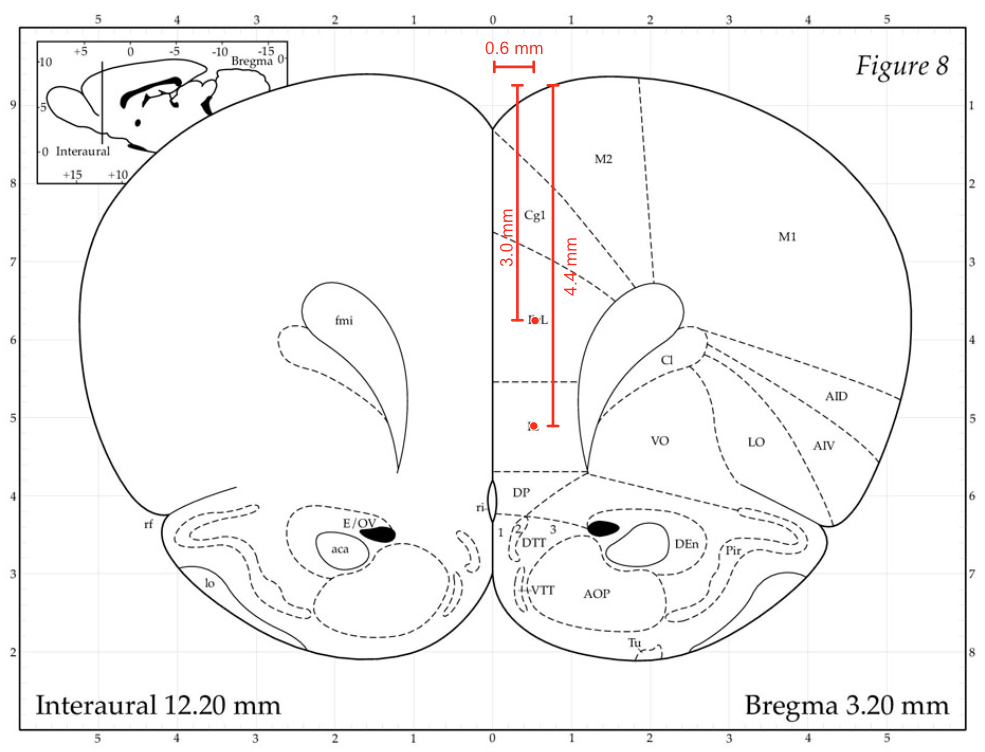

# BGF3: PL/IL lesion, 2026-01-09

| | |
|---|---|
| Target | PL + IL, bilateral |
| Weight | 285 g |
| Drug | NMDA 0.12 M, 90 nl per site |
| Infusion | robotic, 1 nl/s (1.5 min for 90 nl) |
| Bregma-lambda | 8.97 mm (not scaled) |

## Injection sites

DV from brain surface.

| Site | AP | ML | DV |
|---|---|---|---|
| PL | 3.2 | 0.6 | 3 |
| IL | 3.2 | 0.6 | 4.5 |
| PL | 3.2 | -0.6 | 3 |
| IL | 3.2 | -0.6 | 4.5 |

## Notes

- Taken for surgery because it was biased towards one port.
- Drug tube was mixed and centrifuged before injecting. Loading the Hamilton syringe from parafilm was easier than from the eppendorf tube.
- Perfusion date in the old sheet: 2026-01-18. The log says it was removed from the OpCon cage on 2026-01-21 (verify).

## Plan

