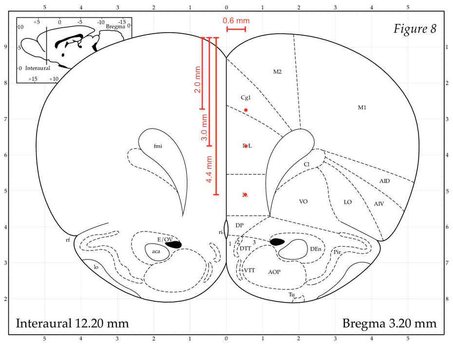

# Neymar: ACC/PL/IL lesion, 2026-02-18

| | |
|---|---|
| Target | ACC + PL + IL (hemisphere not stated) |
| Weight | 350 g |
| Drug | NMDA 0.12 M, 100 nl per site |
| Bregma-lambda | 9 mm (not scaled) |

## Injection sites

DV from brain surface.

| Site | AP | ML | DV |
|---|---|---|---|
| IL | 2.7 | 0.7 | 4.3 |
| PL | 2.7 | 0.7 | 3 |
| ACC | 2.7 | 0.7 | 2 |
| IL | 3.14 | 0.7 | 4.5 |
| PL | 3.14 | 0.7 | 3 |
| ACC | 3.14 | 0.7 | 2 |

## Notes

- Aarushi's animal, previously trained on the unstructured task but a poor performer.
- Drug volume increased to enlarge the lesion.
- Only +ML coordinates were written down.

## Plan

